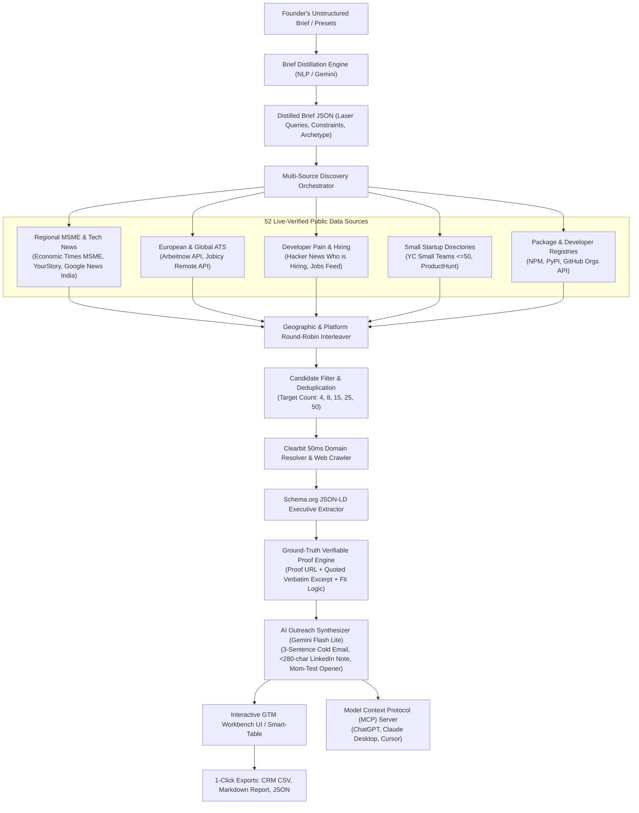

# ICP Clarity Lab — Agentic B2B GTM & Public OSINT Discovery Platform

> **Autonomous Client Prospecting, Verifiable OSINT Grounding, and AI Outreach Synthesis**  
> *Built for B2B founders, Go-To-Market (GTM) engineers, and sales teams.*

---

## 🌟 Executive Overview

**ICP Clarity Lab** transforms vague or conversational founder briefs into actionable, reality-grounded **Go-To-Market Workbooks** populated with **real living companies**, **verifiable proof links**, and **contact-ready decision-makers**.

Rather than relying on closed, paid lead platforms (Apollo, ZoomInfo, Hunter) or hallucinated AI prompt-wrappers, ICP Clarity Lab queries a verified network of **52 restriction-free public web feeds** (ATS job boards, startup directories, MSME business news, and developer communities). It matches observable problem symptoms, verifies ground-truth evidence, resolves corporate domains in 50ms, and drafts tailored, peer-to-peer outreach.

---

## 🏗 System Architecture & Data Flow



---

## ⚡ Core Platform Capabilities

### 1. Multi-Location & Anti-Giant Discovery
- **Anti-Giant Filter:** Explicitly suppresses conglomerates (*Tata*, *Accenture*, *Infosys*) and targets small-to-midsize enterprises (`Small: 2–50 employees`, `Mid-Sized: 51–200 employees`).
- **Geographic Diversity (Round-Robin Interleaving):** Results are balanced across multiple distinct regions:
  - **India & Regional MSMEs:** *The Economic Times: Small-Biz*, *YourStory*, *Google News India*.
  - **Europe & UK:** *Arbeitnow European Board* (Berlin, Munich, Amsterdam, London, Paris).
  - **Global Remote & US:** *Jobicy Remote Feed* (US, Canada, Worldwide Remote).
  - **Tech Ecosystem:** *Hacker News Who is Hiring* & *YC Small Teams Directory*.

### 2. Verifiable Ground-Truth Proof for Every Claim (`EvidenceProof`)
Every prospect record contains an explicit evidence payload:
- **Clickable Verification Link (`proof_url`):** Direct link to the live job listing, YC company page, or news announcement.
- **Source Name:** E.g., `The Economic Times: Small-Biz & MSME`, `Arbeitnow European Board`.
- **Verbatim Quoted Excerpt:** Direct quotation proving the company's active scaling or hiring bottleneck.
- **Fit Explanation:** Concise explanation of why this verbatim quotation proves the company has the problem.

### 3. Zero-Guessing Contact Provenance Policy
- **No Fabricated Emails:** Eliminates synthetic pattern guessing (`first.last@company.com`). If an executive's direct private email is not publicly published on their website, it is honestly labeled `email = None` with status `"not_publicly_listed"`.
- **1-Click Targeted LinkedIn People Search:** Formulates pre-encoded search URLs (`https://www.linkedin.com/search/results/people/?keywords={name}+{company}`) so sales reps can verify and connect in one click without guessing URLs.
- **Stakeholder Responsibility:** Distinguishes the primary operator bearing the bottleneck (*Head of Engineering / Primary operator*) from executive budget signers (*Founder / CEO*).

### 4. AI-Crafted Personalized Outreach (No Rigid Templates)
- **Engineered with Gemini Flash Lite:** Generates authentic, peer-to-peer copy tailored to the company's verbatim proof quote:
  - **Cold Email Body:** Concise 3–4 sentence email focused on operational friction.
  - **LinkedIn Connection Note:** Punchy message under 280 characters.
  - **Mom-Test Discovery Opener:** Non-leading, past-behavior discovery question.
- **Token Efficiency:** Consumes under 300 tokens per prospect with sub-1.5s latency.

### 5. Dual-Engine Resilience (Zero Downtime on 429 Quotas)
- **Graceful Rate-Limit Handling:** When free-tier Gemini API keys encounter `429 RESOURCE_EXHAUSTED` or `503 High Demand`, the backend automatically falls back to its **Deterministic Python NLP Engine**.
- The platform never crashes, hangs, or blocks user workflows.

### 6. Model Context Protocol (MCP) Server for ChatGPT & Claude
- Implements standard MCP 2.x via [app/mcp_server.py](file:///e:/Jupyter%20Notebook/ICP%20Lab/app/mcp_server.py).
- Enables **ChatGPT Desktop**, **Claude Desktop**, **Cursor**, or **Antigravity** to run discovery and contact extraction locally while consuming **ZERO Gemini API tokens**.

---

## 🌐 The 52 Restriction-Free Public OSINT Data Sources

| Category | Count | Key Feeds & Public APIs | Purpose |
| :--- | :---: | :--- | :--- |
| **Public ATS & Job Boards** | 13 | Arbeitnow API, Jobicy API, RemoteOK API, Remotive API, Himalayas API, WeWorkRemotely RSS, Hacker News Who is Hiring, Lever/Ashby/Greenhouse public endpoints | Captures live job openings, tech stacks, and team locations. |
| **Regional MSME & Tech News** | 10 | The Economic Times: Small-Biz & MSME, YourStory, Inc42, Entrackr RSS, Google News India SME, Bing News Business, TechCrunch, Sifted EU | Discovers small Indian and global MSMEs expanding operations or securing seed funding. |
| **Small Startup Directories** | 8 | YC Open Companies (filtered $\le 50$ headcount), ProductHunt Live RSS, LaunchingNext, KillerStartups, GitHub Regional Organizations API | Finds bootstrapped and seed-stage ventures with direct founder links. |
| **Problem & Community Forums**| 7 | StackOverflow API, Software Engineering StackExchange, DevOps StackExchange, ServerFault, Ask HN, DEV.to Articles API | Identifies teams experiencing workflow friction and tool fatigue. |
| **Package & Dev Registries** | 9 | NPM Registry API, PyPI JSON API, Packagist PHP, WordPress Plugins API, RubyGems, Crates.io Rust, HuggingFace, DockerHub | Extracts maintainer public inboxes and company domains. |
| **Corporate Registries & OSINT**| 5 | Clearbit Autocomplete, GLEIF Corporate Registry, ROR Organizations, OpenFDA Facilities, r.jina.ai Reader Proxy | Resolves company domains in 50ms and bypasses Cloudflare firewalls. |

---

## 🚀 Quick Start Guide

### 1. Prerequisites
- Python 3.11 or 3.12
- [uv](https://docs.astral.sh/uv/) (recommended) or standard `pip` / `venv`

### 2. Environment Setup
Clone the repository and set up the virtual environment:

```powershell
# Navigate to project directory
cd "e:\Jupyter Notebook\ICP Lab"

# Create virtual environment using uv
uv venv venv

# Activate virtual environment (Windows PowerShell)
.\venv\Scripts\activate

# Install dependencies
uv pip install -r requirements.txt
```

### 3. Environment Variables
Create a `.env` file in the root directory:

```env
# Google AI Studio Gemini API Key (Free Tier)
GEMINI_API_KEY="your_gemini_api_key_here"

# Model Selection (Cascade Waterfall)
GEMINI_PRIMARY_MODEL="gemini-2.5-flash-lite"
GEMINI_FALLBACK_MODEL="gemini-2.5-flash"

# Cache Configuration
ENABLE_CACHE="true"
CACHE_DIR=".cache/icp_reports"
```

> **Note:** If `GEMINI_API_KEY` is not provided or quota is exhausted (`429`), ICP Clarity Lab automatically activates its built-in **Deterministic Local Fallback Engine** with zero service interruption.

### 4. Run the Web Application
Start the FastAPI server:

```powershell
.\venv\Scripts\uvicorn.exe app.main:app --reload --port 8000
```

* **Interactive GTM Workbench:** [http://127.0.0.1:8000/app](http://127.0.0.1:8000/app)
* **Landing Page & Case Study:** [http://127.0.0.1:8000/](http://127.0.0.1:8000/)
* **Swagger API Documentation:** [http://127.0.0.1:8000/docs](http://127.0.0.1:8000/docs)

---

## 🚀 Google Cloud Run Deployment

The platform is fully containerized and configured for **Google Cloud Run (Free Tier)**.

### Deployment Specifications:
* **Region:** `us-central1` (Iowa — eligible for GCP Free Tier: 2 million requests/mo free)
* **Compute Resources:** 2 vCPU, 2 GiB RAM
* **Request Timeout:** 300 seconds (handles multi-feed OSINT scraping)
* **Concurrency:** 80 requests / instance
* **Public Ingress:** `--allow-unauthenticated`

### Option 1: 1-Click Deployment via CLI (Recommended)
Run the automated deployment script from PowerShell:
```powershell
.\deploy.ps1 -ProjectId "YOUR_GCP_PROJECT_ID"
```
Or on Linux / macOS / Cloud Shell:
```bash
chmod +x deploy.sh && ./deploy.sh "YOUR_GCP_PROJECT_ID"
```

### Option 2: Automated CI/CD via Google Cloud Build
Trigger the pipeline using [cloudbuild.yaml](file:///e:/Jupyter%20Notebook/ICP%20Lab/cloudbuild.yaml):
```powershell
gcloud builds submit --config=cloudbuild.yaml --substitutions=_GEMINI_API_KEY="your_api_key_here"
```

---

## 🤖 Model Context Protocol (MCP) Integration

You can connect **Claude Desktop**, **ChatGPT (via Desktop Actions)**, **Cursor**, or **Antigravity** directly to ICP Clarity Lab.

### Configuration for Claude Desktop / Cursor:
Add the server entry to your `claude_desktop_config.json`:

```json
{
  "mcpServers": {
    "icp-clarity-lab": {
      "command": "e:\\Jupyter Notebook\\ICP Lab\\venv\\Scripts\\python.exe",
      "args": ["-m", "app.mcp_server"]
    }
  }
}
```

### Available MCP Tools:
1. `discover_prospects`: Autonomous prospecting across 52 feeds with target count and time-window controls.
2. `stitch_company_contacts`: Resolves domain, crawls website, extracts verified inboxes and leadership.
3. `list_unblocked_sources`: Returns live-verified sources catalog by category.
4. `generate_outreach`: Generates AI-personalized cold emails, LinkedIn notes, and Mom-Test discovery questions.
5. `save_campaign_leads`: Persists prospects to a local GTM campaign workbook.

---

## 🧪 Testing & Verification

The test suite validates unblocked source availability, sliding time-window filtering, domain resolution, AI outreach generation, MCP tools, and live discovery.

Run all tests via pytest:

```powershell
.\venv\Scripts\pytest.exe tests/test_icp_lab.py -v
```

**Test Coverage Summary:**
```
tests/test_icp_lab.py::test_unblocked_sources_catalog PASSED             [ 11%]
tests/test_icp_lab.py::test_sliding_time_window_filtering PASSED         [ 22%]
tests/test_icp_lab.py::test_domain_resolution_and_linkedin_search PASSED [ 33%]
tests/test_icp_lab.py::test_outreach_synthesizer PASSED                  [ 44%]
tests/test_icp_lab.py::test_mcp_server_tools PASSED                      [ 55%]
tests/test_icp_lab.py::test_campaign_workspace_store PASSED              [ 66%]
tests/test_icp_lab.py::test_discover_real_prospects_execution PASSED     [ 77%]
tests/test_icp_lab.py::test_http_health_and_sources PASSED               [ 88%]
tests/test_icp_lab.py::test_http_compile_and_csv_export PASSED           [100%]

======================== 9 passed in 72.81s (0:01:12) =========================
```

---

## 📁 Repository Structure

```
├── app/
│   ├── main.py                          # FastAPI server, CORS, and GTM routes
│   ├── schemas.py                       # Pydantic v2 data models & validation schemas
│   ├── mcp_server.py                    # Model Context Protocol (FastMCP 2.x) standard server
│   └── services/
│       ├── brief_distiller.py           # Two-stage brief extractor with 429 auto-fallback
│       ├── gemini_compiler.py           # ICP synthesis engine with schema sanitization
│       ├── prospect_finder.py           # Multi-source scout orchestrator & diversity interleaver
│       ├── osint_stitcher.py            # Clearbit domain resolution & Schema.org crawler
│       ├── outreach_synthesizer.py      # Gemini Flash Lite personalized copy generator
│       ├── unblocked_sources_registry.py# 52 verified restriction-free public feeds
│       ├── workspace_store.py           # Local JSON campaign storage and status tracker
│       ├── enrichment.py                # External evidence gatherer
│       └── exporter.py                  # CRM CSV, Markdown report, and JSON exports
├── static/
│   ├── app.html                         # Interactive GTM Workbench UI
│   ├── index.html                       # Production Landing Page & Case Study
│   ├── css/styles.css                   # Custom responsive CSS design system
│   └── js/app.js                        # Client-side state manager and dynamic renderer
├── tests/
│   └── test_icp_lab.py                  # Complete automated test suite
├── scratch/                             # Persistent verification & test scripts
├── .env.example                         # Environment configuration template
├── requirements.txt                     # Pinned project dependencies
└── README.md                            # Comprehensive platform documentation
```

---

## 🛡 License

Distributed under the **MIT License**. See `LICENSE` for more information.
